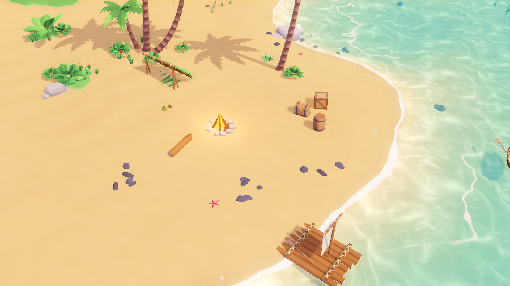

# PARADISE UNTAMED

A 2.5D tropical island survival, fishing, spearfishing and exploration game
built in **Godot 4.4** (Forward+, GDScript). Every 3D asset is generated by
version-controlled **Blender Python** scripts, guided by the two references
in `references/`.

> **Status: v0.2 environment refinement (art direction approved on v0.1).**
> See `docs/VISUAL_REVIEW_v0.2.md` and `docs/TASKS.md`.



## Repository layout

```
references/          the two official visual references
docs/
  REFERENCE_ASSET_INVESTIGATION.md   Phase 0 source research (read first)
  ART_BIBLE.md                       binding visual rules + sampled palette
  ASSET_MANIFEST.csv                 every asset: origin, licence, approval
  TASKS.md / ../CHANGELOG.md         running task list and history
  TOOLCHAIN.md                       how Godot/Blender were installed and run
  screenshots/                       genuine in-engine captures only
tools/
  blender/           bpy asset generators (palms, rocks, props, foliage, terrain, layout)
  palette/           reference colour sampler
  build_all.sh       rebuild assets -> Godot import -> Haven scene
game/                the Godot project (open game/project.godot)
  assets/models/     generated GLBs (do not hand-edit; rebuild instead)
  assets/terrain/    heightmap + set-dressing layout
  shaders/           water, terrain, stylised vertex-colour shaders
  materials/         shader materials + daylight environment
  scenes/            main, world/haven_island, camera, props, debug/lookdev
  scripts/           camera, world (island, water, scatter), props, core, debug
  tools/             headless scene builder + smoke test
```

## Running

Open `game/project.godot` in Godot 4.4+ and press Play.

| Input | Action |
|---|---|
| WASD / arrows | Move (camera-relative) |
| Shift | Run |
| Ctrl / C (hold, in deep water) | Dive |
| Mouse wheel, `+` / `-` | Zoom |

Walk into water deeper than about 1 m to swim.

## Rebuilding assets

```sh
tools/build_all.sh               # all groups
tools/build_all.sh palms rocks   # selected groups (palms rocks props foliage terrain character)
```

This needs Blender's `bpy` module (`pip install bpy==5.2.2` on Python 3.13)
and Godot 4.4 on `PATH`. Override with `BPY_PYTHON` / `GODOT`.

## Validation

```sh
godot --headless --path game --script res://tools/smoke_test.gd      # world checks
godot --headless --path game --script res://tools/player_test.gd     # controller with simulated input
godot --path game -- --capture=/abs/out.png --view=26,0.5,21.5,18,18,-40,38   # screenshot
```

`--view` is `focus_x,focus_y,focus_z,view_size,yaw,pitch[,fov]` (fov 0 = orthographic). See
`game/scripts/debug/screenshot_capture.gd` for batch captures.
